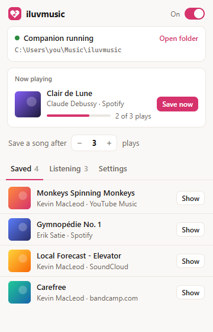
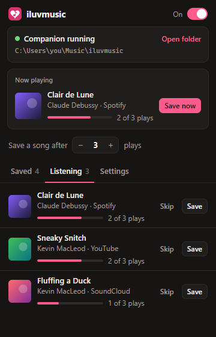

# iluvmusic

Keep listening to music the way you already do. When you play a song enough
times (3 by default, and you can change that), iluvmusic saves it to your
computer as an MP3. You never have to download your playlist by hand.

Works on YouTube Music, YouTube, Spotify, SoundCloud and most other sites that
play audio, in Chrome, Edge, Brave, Opera, Vivaldi and Firefox.

<p align="center">
  
  &nbsp;
  
</p>

<sub>The screenshots use a demo library of Creative Commons and public-domain music.</sub>

## How it works

There are two parts:

1. **The browser extension** notices what's playing and counts how many times
   you've listened to each song. A play counts once you've heard half the song
   (or 4 minutes of it, whichever is shorter). Skipping ahead doesn't count,
   and starting the song over counts as another play.
2. **The companion app** runs quietly on your computer. When a song reaches
   your number, the extension hands it over, and the companion saves it as an
   MP3 (with title, artist, album and cover art) using
   [yt-dlp](https://github.com/yt-dlp/yt-dlp) and ffmpeg.

The companion is needed because a browser extension can't turn a stream into
an MP3 on its own. It only listens on `127.0.0.1` and turns away requests from
websites, so nothing but the extension can use it.

**Spotify, Apple Music, Deezer, Tidal and Amazon Music** protect their audio
with DRM, so iluvmusic doesn't touch their streams. It takes the artist and
title, finds the same song on YouTube Music, and saves that instead. It also
uses the song's length to pick the right version.

## Setup

### 0. Get the code

Click **Code → Download ZIP** on this page and unzip it somewhere you'll keep
it, or run:

```
git clone https://github.com/satanrayshe/iluvmusic.git
```

Keep the folder where it is after setup: the browser loads the extension from
it, and the companion runs from it.

### 1. Start the companion

You need [Python 3.9 or newer](https://www.python.org/downloads/). On Windows,
tick "Add python.exe to PATH" when you install it.

- **Windows:** double-click `companion/start-windows.bat`.
- **Mac / Linux:** run `companion/start-mac-linux.sh`.

The first run sets everything up, which takes about a minute. It then asks
whether to start automatically when you sign in. Say yes so you never have to
think about it again.

Songs are saved to `Music/iluvmusic` in your home folder. You can change this
from the extension's Settings tab, or run the companion with `--dir "D:\My Music"`.

For YouTube to work, yt-dlp needs a JavaScript runtime: either
[Deno](https://deno.com) (`winget install DenoLand.Deno`) or
[Node.js](https://nodejs.org). If you don't have one, the popup tells you.
ffmpeg comes bundled, so you don't need to install it.

### 2. Add the extension

**Chrome, Edge, Brave, Opera, Vivaldi, Arc:**

1. Go to `chrome://extensions` (Edge: `edge://extensions`).
2. Turn on **Developer mode**.
3. Click **Load unpacked** and choose the `extension` folder.

**Firefox (version 128 or newer):**

1. Go to `about:debugging#/runtime/this-firefox`.
2. Click **Load Temporary Add-on** and choose `extension/manifest.json`.

A temporary add-on goes away when Firefox restarts. To keep it, sign it
through [addons.mozilla.org](https://addons.mozilla.org/developers/) as an
unlisted add-on. Run `python tools/package.py` to get the zip to upload. If
Firefox shows a banner in the popup asking for site access, click **Allow access**.

**Safari:** on a Mac with Xcode, run
`xcrun safari-web-extension-converter extension/` and build the project it creates.

> The Chrome Web Store doesn't allow extensions that download from YouTube, so
> on Chromium browsers this stays a "Load unpacked" extension.

## Using it

Click the pink heart in your toolbar to see:

- whether the companion is running, and where your songs are saved
- what's playing now, and how close it is to being saved
- **Save a song after N plays**, your number
- **Saved**: every song that's been saved. Click **Show** to open it in your file manager.
- **Listening**: songs on their way, with play counts. You can **Save** one
  right away, or **Skip** it so it's never saved.
- **Settings**:
  - count songs on other websites
  - on YouTube, only count music (skips vlogs and tutorials)
  - the shortest and longest track lengths to count
  - notifications
  - your music folder

Songs keep being counted while the companion is off. Anything that's due gets
saved as soon as it's running again.

What isn't counted: ads, YouTube Shorts, podcasts, muted videos, live streams,
and anything shorter than 30 seconds or longer than 15 minutes. You can change
both length limits in Settings.

## Where things live

| What | Where |
| --- | --- |
| Your MP3s | `~/Music/iluvmusic` (or the folder you chose) |
| Library index | `~/.iluvmusic/library.json` |
| Companion settings | `~/.iluvmusic/config.json` |
| Companion log | `~/.iluvmusic/companion.log` |
| Play counts | the browser's extension storage |

## Cloud library (planned)

`library.json` is built so it can be synced later. Every saved song has a
stable id, where it came from, and where the file sits on disk. The idea is
for the companion to upload new MP3s and that index to a storage bucket, so
you can open your library from any device. The extension and the local files
won't need to change for that.

## When something goes wrong

- **"Companion app isn't running"**: start it (see setup). If it closes right
  away, read `~/.iluvmusic/companion.log`.
- **YouTube songs fail with "Sign in to confirm…" or format errors**: YouTube
  changed something. The companion updates yt-dlp once a day on its own;
  restart it to pick up the new version. Also make sure Deno or Node.js is installed.
- **A song didn't count**: open the popup while it plays. The "Now playing"
  card says why if it's being skipped.
- **Wrong version of a Spotify song**: the match is made by name and length.
  Delete the file, and use **Save** from the Listening tab after playing the
  song on YouTube Music instead.

## A note on copyright

Saving music you don't own the rights to can break the terms of the sites
you're listening on, and copyright law where you live. iluvmusic is a
personal tool. What you save, and what you do with it, is up to you.

## For developers

```
extension/            the browser extension (Manifest V3, one build for every browser)
  content/hook.js     runs in the page; finds the playing media and reads player data
  content/bridge.js   decides what counts as a play
  background.js       play counts, the save queue, talking to the companion
  popup/              the toolbar popup
companion/            the local MP3 saver (Python, yt-dlp, ffmpeg)
tests/                end-to-end and API tests
tools/                icon generator, packaging script
store/                512px icon for store listings
docs/                 README screenshots
```

Tests (after running the companion setup once):

```
python tests/companion_api_test.py   # safety rules, saving, de-duplication, autostart
python tests/e2e_test.py             # real extension in Chromium + real companion
```

The end-to-end test needs Playwright for Python with Chromium installed.
